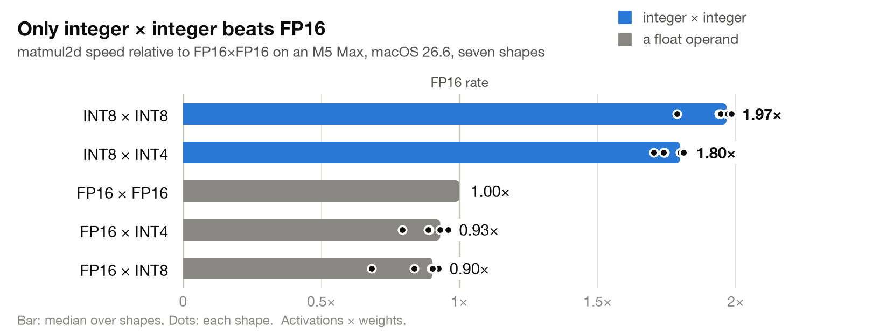
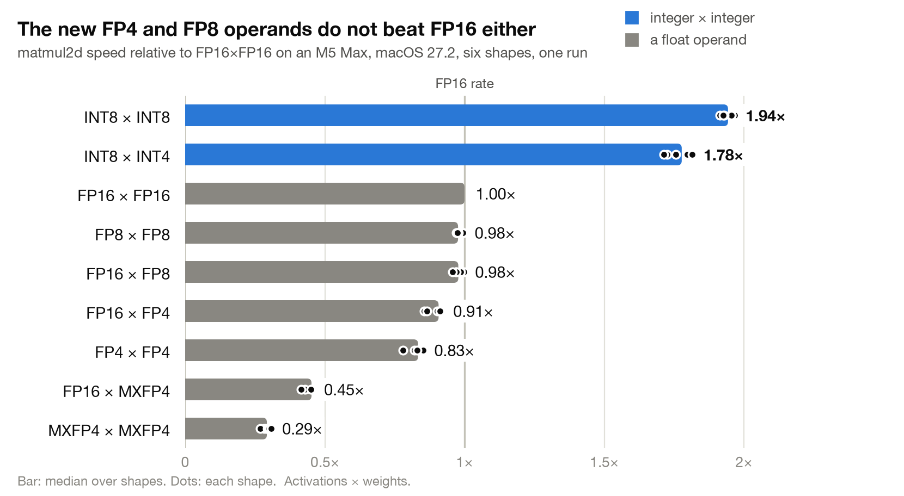
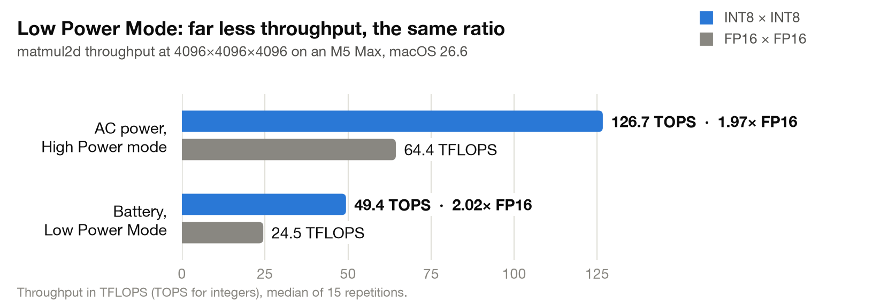

# Which operand types does the M5 GPU's matrix unit speed up?

*November 2026 · first post in a series on running 4-bit language models through the M5's integer matrix path*

Integer times integer, and nothing else. On an M5 Max, a matrix multiply with both operands in INT8 runs at 1.79–1.98× the FP16 rate. As soon as one operand is a float, the multiply runs at the FP16 rate or below it. That includes the FP4 and FP8 operand types that macOS 27 added.

<picture>
  <source media="(prefers-color-scheme: dark)" srcset="img/operand-types-dark.png">
  
</picture>

This matters for anyone running 4-bit language models on a Mac. MLX and llama.cpp keep activations in FP16 and convert the 4-bit weights to floats inside the multiply, so processing the prompt runs at the FP16 rate. The faster path is there, and the common 4-bit setups do not reach it.

**In short:**

- INT8×INT8 reaches 109–127 TOPS, against 55–66 TFLOPS for FP16.
- Integer weights with float activations are *slower* than plain FP16.
- The FP8 type added in macOS 27 runs at the FP16 rate, and FP4 runs below it.
- A scale applied per block of 32 values, as in MXFP4, costs more than half the speed.

## Reaching the matrix unit

The M5 GPU has matrix units, which Apple calls Neural Accelerators. A Metal 4 shader reaches them through tensor types and the `matmul2d` operation in MetalPerformancePrimitives. On macOS 26.6 the headers accept `half`, `bfloat`, `float`, `int8` and `uint8` operands, plus a packed 4-bit integer type. Apple does not publish throughput per operand type, so we timed it.

The whole benchmark kernel is a few lines. Each thread group computes one 128×64 tile of the output with a single call (trimmed from `kernels/matmul.metal`):

```cpp
template <typename TA, typename TB, typename TOut, typename PB>
inline void tile_mm(device TA *A, PB B, device TOut *C, uint3 dims, uint2 tgid, uint2 grid)
{
    const int M = dims.x, N = dims.y, K = dims.z;
    // Extents are (innermost, outer): a row-major M x K matrix is (K, M).
    tensor<device TA, dextents<int32_t, 2>, tensor_inline> tA(A, dextents<int32_t, 2>(K, M));
    tensor<device TB, dextents<int32_t, 2>, tensor_inline> tB(B, dextents<int32_t, 2>(K, N));
    tensor<device TOut, dextents<int32_t, 2>, tensor_inline> tC(C, dextents<int32_t, 2>(N, M));

    const uint2 t = tile_coords(tgid, grid);
    const int m0 = t.x * TM, n0 = t.y * TN;
    constexpr auto desc = matmul2d_descriptor(TM, TN, dynamic_length_v<int>, false, true, false,
                                              matmul2d_descriptor::mode::multiply);
    matmul2d<desc, execution_simdgroups<NSG>> op;
    auto mA = tA.slice(0, m0);
    auto mB = tB.slice(0, n0);
    auto mC = tC.slice(n0, m0);
    op.run(mA, mB, mC);
}
```

Every operand pairing is this same function with different types, so the types are the only thing that changes between the kernels we compare:

```cpp
KERNEL(mm_f16_f32, half, half, float)         // FP16, FP32 out (baseline)
KERNEL(mm_i8_i32, int8_t, int8_t, int32_t)    // W8A8
KERNEL(mm_f16xi8_f32, half, int8_t, float)    // W8A16
KERNEL4(mm_i8xi4_i32, int8_t, int32_t)        // W4A8 (INT4 weights)
KERNEL4(mm_f16xi4_f32, half, float)           // W4A16 (INT4 weights)
```

## How we timed it

- **Kernel:** one `matmul2d` call per 128×64 output tile, 4 SIMD groups per thread group, operands read straight from device memory.
- **Inputs:** small integers in −8..7, so every operand type computes the same product. We compared 256 random output entries against the exact result, and the largest error was 0 for every type.
- **Timing:** every repetition runs all kernels back to back after a 1 s warm-up. We report the median of 15 repetitions, and each speedup is the median of the per-repetition ratios.
- **Machine:** M5 Max, 128 GB, AC power, High Power mode, macOS 26.6.2.

A shape M×N×K means M activation rows (tokens), N outputs and K inputs, with K the dimension that is summed over. Pairings are written activations × weights.

## Results

The chart at the top is this run. It says three things:

1. **INT8×INT8 is about twice as fast as FP16.** It reaches 109–127 TOPS against 55–66 TFLOPS, which is 1.79–1.98× across the seven shapes.
2. **INT8 activations with packed INT4 weights reach 1.70–1.82×.** This is a little slower than INT8×INT8 and still far ahead of FP16.
3. **A float activation with integer weights is slower than plain FP16.** FP16×INT8 and FP16×INT4 run at 0.68–0.96× the FP16 rate. The likely reason is that the integer operand is converted to a float before the multiply, though we did not confirm it.

The third point is the one that affects deployed models. Quantizing only the weights buys memory and nothing else on this unit. The integer rate needs integer activations and integer weights together.

The output type did not matter. Writing FP16 results was no faster than writing FP32 results under sustained load.

<details>
<summary>Full table: throughput per shape</summary>

Throughput in TFLOPS (TOPS for integers), with the speedup over FP16 in parentheses.

| M×N×K | FP16×FP16 | INT8×INT8 | INT8×INT4 | FP16×INT8 | FP16×INT4 |
|---|---|---|---|---|---|
| 512×4096×4096 | 54.9 | 108.7 (1.97×) | 95.5 (1.74×) | 45.9 (0.84×) | 48.9 (0.89×) |
| 1024×4096×4096 | 55.6 | 110.2 (1.98×) | 94.9 (1.70×) | 50.3 (0.90×) | 49.5 (0.89×) |
| 4096×4096×4096 | 64.4 | 126.7 (1.97×) | 116.3 (1.81×) | 58.5 (0.91×) | 60.8 (0.94×) |
| 2048×8192×8192 | 59.6 | 118.9 (1.98×) | 108.1 (1.81×) | 53.2 (0.90×) | 55.8 (0.93×) |
| 4096×14336×4096 | 65.4 | 127.4 (1.95×) | 117.8 (1.80×) | 60.5 (0.92×) | 62.8 (0.96×) |
| 4096×4096×14336 | 63.9 | 114.2 (1.79×) | 111.5 (1.74×) | 43.5 (0.68×) | 50.7 (0.79×) |
| 8192×8192×4096 | 65.6 | 127.3 (1.94×) | 119.3 (1.82×) | 60.1 (0.92×) | 62.8 (0.96×) |

</details>

## FP4 and FP8 operands on macOS 27

macOS 27 adds FP4 (E2M1) and FP8 (E4M3, E5M2) operand types to `matmul2d`, along with a block-scaled tensor that carries one power-of-two scale per 32 values, which is the MXFP4 layout. The obvious hope is that these make a 4-bit float format fast without any integer tricks. We reran the benchmark on macOS 27.2 with these types next to the earlier ones. This is a single run, on the same machine on AC power.

<picture>
  <source media="(prefers-color-scheme: dark)" srcset="img/fp-types-dark.png">
  
</picture>

- **FP8 runs at the FP16 rate.** It saves memory and adds no speed. E5M2 gave the same ratios as E4M3 (0.97–1.00×).
- **FP4 is slower than FP16**, at 0.78–0.85× with both operands in FP4 and 0.86–0.92× with FP16 activations.
- **Block scales are expensive.** With the scale plane attached, the multiply drops to 0.41–0.46× FP16 for FP16 activations and 0.27–0.31× when both operands are MXFP4. These are the kernels as we wrote them, and a better use of the API may exist.
- **INT8×INT8 keeps its lead** at 1.91–1.97× in the same run.

One shape is left out of the chart. At 4096×4096×14336 the FP16 baseline itself came out low in this run (41.8 TFLOPS, against 63.9 on macOS 26.6), which lifts every ratio for that shape: INT8×INT8 reads 2.23× and FP8 1.23×. We do not know why, so we report it separately. The absolute numbers of the two runs are also from different OS versions and days, so only compare ratios within a run.

<details>
<summary>Full table: speedup over FP16 per shape, macOS 27.2</summary>

"FP8" is E4M3. "MXFP4" is the FP4 type with the per-32 scale plane.

| M×N×K | FP16 (TFLOPS) | INT8×INT8 | FP8×FP8 | FP4×FP4 | FP16×FP4 | FP16×MXFP4 | MXFP4×MXFP4 |
|---|---|---|---|---|---|---|---|
| 512×4096×4096 | 46.6 | 1.93× | 0.98× | 0.78× | 0.86× | 0.41× | 0.30× |
| 1024×4096×4096 | 46.5 | 1.93× | 0.97× | 0.83× | 0.87× | 0.45× | 0.31× |
| 4096×4096×4096 | 61.9 | 1.97× | 1.00× | 0.85× | 0.92× | 0.45× | 0.29× |
| 2048×8192×8192 | 45.3 | 1.91× | 0.98× | 0.85× | 0.91× | 0.43× | 0.29× |
| 4096×14336×4096 | 54.5 | 1.96× | 0.97× | 0.82× | 0.90× | 0.46× | 0.27× |
| 8192×8192×4096 | 58.2 | 1.96× | 0.99× | 0.84× | 0.92× | 0.46× | 0.28× |

</details>

## Three things that cost us time

**Weight layout.** Storing the weights N×K, with the summed dimension contiguous, is about 2× faster than K×N for every operand type.

**Splitting the sum.** Larger tiles (up to 256×256) and an explicit loop over K in chunks of 32–256 were never faster than one `matmul2d` call over the whole K. Chunks of 32 were about 2× slower. That matters for MXFP4, whose scales change every 32 values: applying them inside the sum means paying for exactly this split.

**Power state.** On battery with Low Power Mode, sustained throughput falls to about a third (FP16 near 23 TFLOPS). The ratios stay the same, with INT8×INT8 at 1.85–2.04×, so the integer advantage is not a power-state artifact.

<picture>
  <source media="(prefers-color-scheme: dark)" srcset="img/low-power-dark.png">
  
</picture>

One more, less about the hardware: zsh does not split an unquoted `$var` into words, and an early sweep silently ran every shape with the default arguments.

## What this means for 4-bit models

Three constraints follow from the numbers:

- The activations have to be INT8, or the multiply runs at the float rate whatever the weights are.
- The scales cannot be applied inside the sum, because splitting the sum by block costs more than the integer path gains.
- The packed INT4 operand holds −8..7. The FP4 codebook, doubled to make it integer, spans ±12, so it does not fit INT4. It does fit INT8.

So the question becomes whether a 4-bit float format, block scales included, can be written as plain INT8 weights with one scale per output row. For standard MXFP4 it almost always can, exactly. That is the next post.

## Limits

- This is one machine, an M5 Max. Others have reported similar ratios on other M5 and M6 chips, which we did not measure ourselves.
- These are isolated multiplies. A whole model has other costs, and in our system prompt processing on a dense model is 1.43–1.72× faster than MLX, not 2×.
- Generating one token at a time is bound by memory bandwidth, not by the multiply. There the integer path gains nothing (0.98–1.03× MLX's speed).

## Reproduce

The kernels and harness are in `kernels/` of [this repository](https://github.com/shinyoungkang1/mxfp4-int8-m5). Run on AC power with Low Power Mode off and other GPU applications closed.

```bash
kernels/run_microbench.sh
```

For the macOS 27 operand types (needs macOS 27.2):

```bash
kernels/run_microbench_fp.sh
```

The method in full and the model-level results are in the paper this code belongs to; see the repository README.
